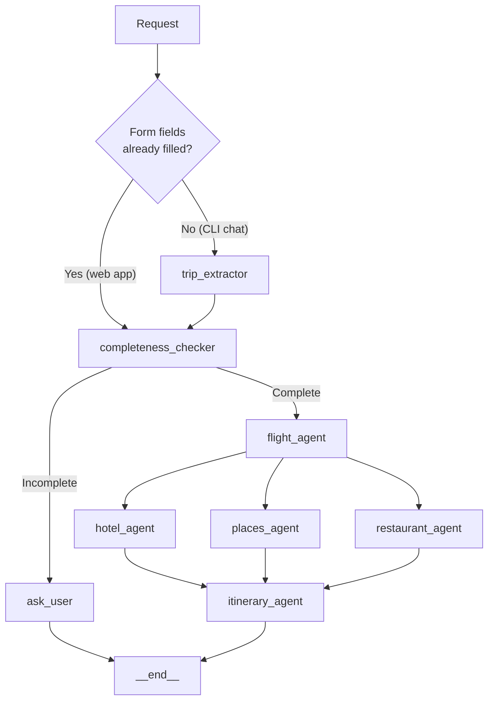

# ✈️ Voyage AI — AI-Powered Travel Planner

> An AI-powered travel planner that turns a few trip details into a personalized, budget-aware, day-by-day itinerary — using a multi-agent LangGraph workflow, Google Gemini, live travel APIs, deterministic cost checks and a React frontend.

**Live Demo:** https://voyageai-rust.vercel.app/

**Backend API:** https://ai-trip-planner-kywc.onrender.com
**Go to `/docs` on the API to test it (Swagger UI).**

**GitHub:** https://github.com/ArmanKhan-git/AI-Trip-Planner

---

## 📌 Overview

Voyage AI automates the process of planning a complete trip.

Instead of manually searching for flights, hotels, restaurants, attractions, prices and travel information, the user picks:

> **Delhi → Tokyo · 28 Nov – 5 Dec 2026 · 1 traveler · ₹5,00,000 budget**

Voyage AI then fetches live flight offers, hotels, restaurants and attractions, lets an AI agent plan the trip, **re-checks every cost in code**, and returns a complete itinerary that can be customized on screen and downloaded as a PDF.

The application combines **LLMs, multi-agent workflows, external APIs, structured outputs, deterministic validation and budget optimization** into one end-to-end AI application.

---

## ✨ Features

### 🧭 Trip Planning Form
- Departure and destination cities (dropdowns limited to supported airports).
- Departure and return dates — the app shows the exact **days / nights** (e.g. 28 Nov → 5 Dec = 8 days / 7 nights).
- Number of travelers (1–9), total budget and currency (**INR** or **USD**).

### ✈️ Flights
- Live round-trip offers from the **Duffel Flight API** (5 cheapest options).
- **Outbound and return legs** shown separately: departure/arrival times, duration and stops.
- Flight times, prices and legs are filled in **from the real API data**, not written by the AI.
- Price is shown per traveler; the budget multiplies it by the number of travelers.

### 🏨 Hotels
- Hotel candidates from **Google Places** (rating and review count).
- The AI picks one hotel and compares 4 alternatives with pros and cons.
- The user can switch to any other hotel; the budget updates instantly.

### 📅 Day-by-Day Itinerary
- Every day has its **calendar date** and a morning / afternoon / evening plan.
- **Flight-time aware:** overnight flights, early-morning arrivals and midnight airport transfers are worked out in code and the plan follows them.
- **Travel days** (e.g. an overnight outbound flight or a 03:05 return flight) show *"dinner at the airport or on board"* instead of a restaurant.
- Attractions from Google Places — never repeated across days.

### 🍜 Dinner Options & Food Budget
- Each evening offers two dinner choices:
  - **Recommended** — a reputable, well-reviewed mid-range restaurant ($$–$$$).
  - **Fine dining** — a high-end ($$$$) alternative; the user can switch per day.
- **Breakfast + lunch allowance** per day (cafés / convenience stores).
- **Google price-range check:** each restaurant's price is validated against Google's typical spend per person (e.g. "JPY 1000-2000"). When Google only gives a minimum (e.g. "JPY 10000+"), the price is shown honestly as **"from ₹X"**.
- Food total = Σ (chosen dinner + breakfast/lunch) × travelers — and it updates live when the user changes a dinner.

### 🔄 Regenerate Itinerary
- If the user picks a different hotel or flight, a banner offers to **re-plan the days** for that choice.
- Only the daily plan is regenerated (~10 s instead of ~30 s) — no new flight or Places API calls.
- Restaurants keep the same prices as in the first plan.

### 💰 Budget Calculated in Code
The AI suggests the plan, but every number in the budget is **recalculated deterministically**:

```text
Flights        = flight price per traveler × travelers
Hotel          = nightly rate × nights
Food           = Σ (dinner + breakfast/lunch) × travelers
Transportation
Miscellaneous
----------------
Total Trip Cost
Remaining Budget   →  Affordable / Over Budget
```

### 📄 PDF Download
- One click downloads a designed PDF of **exactly what's on screen** — chosen flight and hotel, regenerated days and dinner picks — with the budget recalculated.
- Styled like the web app: cover page with the route and trip stats, boarding-pass card, budget bar, day timeline, comparisons, tips and data confidence.
- Named after the trip, e.g. `Delhi_to_Tokyo_8_Days_Plan.pdf`.

### 🔍 Data Confidence
Each category is labelled by where its numbers came from — set in code, not by the AI:

| Category | Source | Confidence |
|---|---|---|
| Flight | Live Duffel offer | High |
| Hotel | Google Places hotel, AI-estimated nightly rate | Medium |
| Food | Google price tiers + AI estimate | Medium |
| Transport / Misc | AI estimate | Medium |

### 📈 AI Observability
The LangGraph workflow is instrumented with **LangSmith** to monitor agent execution, state transitions, latency, token usage, LLM calls and cost.

---

## 🧠 Architecture

```text
                         User
                          │
                          ▼
                 ┌─────────────────┐
                 │   React + Vite  │
                 │    Frontend     │
                 └────────┬────────┘
                          │  REST API
                          │  POST /plan · POST /itinerary · POST /pdf
                          ▼
                 ┌─────────────────┐
                 │     FastAPI     │
                 │     Backend     │
                 └────────┬────────┘
                          │
                          ▼
                 ┌────────────────────────┐
                 │       LangGraph        │
                 │    Agentic Workflow    │
                 └───────────┬────────────┘
                             │
        ┌──────────────┬─────┴────────┬──────────────────┐
        ▼              ▼              ▼                  ▼
   Flight Agent   Hotel Agent   Places Agent    Restaurant Agent
        │              │              │                  │
        ▼              └──────────────┴──────────────────┘
   Duffel API                         │
                               Google Places API
        │                             │
        └──────────────┬──────────────┘
                       ▼
               Itinerary Agent (Gemini)
                       │
                       ▼
     Deterministic checks in code
     (flight data, dates, travel days, price ranges,
      budget, confidence, duplicates)
                       │
                       ▼
               Pydantic Output → JSON → Frontend
                                         │
                                         ├── Regenerate days  → POST /itinerary
                                         └── Download PDF     → POST /pdf
```

---

## 🤖 Multi-Agent Workflow



- **Web app requests** arrive with every field already filled in, so they skip the LLM extractor (one fewer LLM call).
- **CLI requests** (`main.py`) are free-text, so they go through `trip_extractor` and can ask follow-up questions.
- The hotel, places and restaurant agents run **in parallel** before converging on the itinerary agent.
- **Regenerate** (`/itinerary`) runs a smaller day-planning agent with the restaurant and attraction data already fetched.

### AI vs Code — who does what

| AI (Gemini) | Deterministic code |
|---|---|
| Chooses the flight and hotel | Fills flight legs, times, durations and prices from Duffel |
| Writes the day-by-day plan | Calculates dates, nights/days and travel days from flight times |
| Picks restaurants and attractions | Validates restaurant prices against Google price ranges |
| Estimates hotel rates and daily costs | Recalculates flights, hotel, food, total and remaining budget |
| Writes pros/cons and tips | Removes duplicates, sets confidence levels, builds the PDF |

---

## 🧩 Technology Stack

### AI / LLM
- Python
- Google Gemini API (`gemini-3.5-flash-lite`)
- LangChain
- LangGraph
- Prompt Engineering
- Structured LLM Outputs (Pydantic)
- LangSmith

### Backend
- FastAPI
- Pydantic
- REST APIs
- ReportLab (PDF generation)

### Frontend
- React
- Vite
- JavaScript
- HTML
- CSS

### External APIs
- Duffel Flight API
- Google Places API (Text Search, incl. price level and price range)
- Exchange Rate API

### Deployment
- Render — Backend
- Vercel — Frontend

---

## 📂 Project Structure

```text
AI-Trip-Planner/
│
├── agents/          # LangGraph nodes: extractor, flight, hotel, places, restaurant,
│                    # itinerary agent and the regenerate (day plan) agent
├── api/             # FastAPI app, request models and routes (/plan, /itinerary, /pdf)
├── graph/           # LangGraph state and graph definition
├── models/          # Gemini model configuration
├── prompts/         # Itinerary and day-planning prompts
├── routers/         # Conditional routing between graph nodes
├── schemas/         # Pydantic schemas for the itinerary output
├── tools/           # Duffel flights, Google Places, exchange rates, airport lookup
├── utils/           # Budget, dates, day clean-up, price checks, PDF export
│   └── pdfs/        # PDF generator
├── fonts/           # Fonts used in the PDF (SIL Open Font License)
│
├── voyage-frontend/ # React + Vite frontend
│   ├── src/
│   ├── public/
│   └── package.json
│
├── main.py          # CLI version (chat in the terminal)
├── config.py        # Loads API keys from .env
├── requirements.txt
├── FUTURE_SCOPE.md  # Known limitations and roadmap
└── Readme.md
```

---

## 🔌 API Endpoints

| Method | Endpoint | Purpose |
|---|---|---|
| `GET` | `/ping` | Health check (also wakes the Render instance) |
| `POST` | `/plan` | Generate a full trip plan |
| `POST` | `/itinerary` | Regenerate only the day-by-day plan for a chosen flight and hotel |
| `POST` | `/pdf` | Download the itinerary (with the user's choices) as a PDF |

Example `/plan` request:

```json
{
  "departure_city": "Delhi",
  "destination_city": "Tokyo",
  "departure_date": "2026-11-28",
  "return_date": "2026-12-05",
  "travelers": 1,
  "budget": 500000,
  "currency": "INR"
}
```

The response contains the full itinerary (`data`) and the restaurant and attraction lists (`context`) that the frontend sends back to `/itinerary` when the user regenerates.

---

## 💰 Cost Optimization

LangSmith is used to monitor LLM calls, token usage, latency and cost per run.

Measured on an 8-day Delhi → Tokyo trip with `gemini-3.5-flash-lite`:

```text
Full trip plan (/plan)          ≈ $0.02   (~17K tokens, ~28 s)
Regenerate days (/itinerary)    ≈ $0.01   (~11K tokens, ~10 s)
PDF download (/pdf)             $0        (no LLM call)
```

Cost-saving measures:
- Web app requests skip the LLM extractor.
- Regenerating re-plans only the days and re-uses the already-fetched data — no new API calls.
- Data is sent to the model as compact JSON.
- Budget totals, dates and PDFs are computed in code, not by the LLM.

---

## 🛠️ Local Development

### 1. Clone the repository

```bash
git clone https://github.com/ArmanKhan-git/AI-Trip-Planner.git
cd AI-Trip-Planner
```

### 2. Create a virtual environment

#### Windows

```bash
python -m venv venv
venv\Scripts\activate
```

#### Linux / macOS

```bash
python3 -m venv venv
source venv/bin/activate
```

### 3. Install backend dependencies

```bash
pip install -r requirements.txt
```

### 4. Configure environment variables

Create a `.env` file in the project root:

```env
GEMINI_API_KEY=your_gemini_api_key

LANGSMITH_TRACING=true
LANGSMITH_ENDPOINT=https://api.smith.langchain.com
LANGSMITH_API_KEY=your_langsmith_api_key
LANGSMITH_PROJECT=Voyage-AI

DUFFEL_API_KEY=your_duffel_api_key

GOOGLE_PLACES_API_KEY=your_google_places_api_key

EXCHANGE_RATE_API_KEY=your_exchange_rate_api_key
```

Create `voyage-frontend/.env` for the frontend:

```env
VITE_API_URL=http://localhost:8000
```

**Never commit your `.env` files.** They are already listed in `.gitignore`.

---

## 🚀 Run the Backend

```bash
uvicorn api.main:app --reload
```

Backend:

```text
http://localhost:8000
```

Interactive API documentation:

```text
http://localhost:8000/docs
```

---

## 🎨 Run the Frontend

```bash
cd voyage-frontend
npm install
npm run dev
```

Frontend:

```text
http://localhost:5173
```

---

## 🔐 Environment Variables

| Variable | Purpose |
|---|---|
| `GEMINI_API_KEY` | Google Gemini LLM access |
| `LANGSMITH_TRACING` | Enables LangSmith tracing |
| `LANGSMITH_ENDPOINT` | LangSmith API endpoint |
| `LANGSMITH_API_KEY` | LangSmith authentication |
| `LANGSMITH_PROJECT` | LangSmith project name |
| `DUFFEL_API_KEY` | Flight search |
| `GOOGLE_PLACES_API_KEY` | Hotels, attractions and restaurants (incl. price ranges) |
| `EXCHANGE_RATE_API_KEY` | Currency conversion |
| `VITE_API_URL` | Frontend → backend URL (in `voyage-frontend/.env`) |

---

## ☁️ Deployment

### Frontend
Deployed on **Vercel**.

Live application:

https://voyageai-rust.vercel.app/

### Backend
Deployed as a **FastAPI Web Service on Render**.

Backend API: https://ai-trip-planner-kywc.onrender.com

The free Render instance sleeps when idle; the frontend pings `/ping` and shows a "waking up the server" screen until it responds.

---

## 🧪 Testing

FastAPI provides interactive API testing through Swagger UI:

```text
http://localhost:8000/docs
```

```text
Swagger UI (/docs)
    ↓
POST /plan  (paste the example request above)
    ↓
FastAPI
    ↓
LangGraph
    ↓
Agents + External APIs
    ↓
Deterministic checks + Pydantic validation
    ↓
JSON Response
```

---

## ⚠️ Known Limitations

- **Flights** use Duffel's **test mode**, which returns sample offers (including the fictional "Duffel Airways") — switching to live mode only requires a live API key.
- **Hotel rates** are AI estimates; Google Places does not provide room prices or availability.
- **Fine-dining prices** are only partly grounded, because Google's top price bucket is open-ended (e.g. "JPY 10000+").
- **Cities** are limited to the airport lookup table used by the dropdowns.

See **[FUTURE_SCOPE.md](FUTURE_SCOPE.md)** for the full list of limitations and how each would be solved.

---

## 📈 Future Improvements

Planned features include:

- 📸 Photos of hotels, restaurants and attractions
- 🗺️ Google Maps links and a route map for each day
- 🌦️ Weather-aware itinerary planning
- 🔗 "Book this" links, and real flight / hotel booking with Duffel live mode
- 🧳 Traveler preferences (vegetarian / halal food, pace, interests)
- 💬 Chat to edit the plan ("make day 3 more relaxed")
- 👤 Accounts, saved trips and shareable links
- 🌍 Any city and multi-city trips

Each item is described with the API it would use and the effort involved in **[FUTURE_SCOPE.md](FUTURE_SCOPE.md)**.

---

## 🎯 Why Voyage AI?

Traditional travel planning requires users to manually combine information from multiple platforms.

Voyage AI brings these tasks together into one AI-driven workflow:

```text
Trip details
      ↓
Live travel data (flights, hotels, restaurants, attractions)
      ↓
Multi-agent AI planning
      ↓
Deterministic cost & schedule checks
      ↓
Personalized itinerary → customize → regenerate → PDF
```

The project demonstrates how **LLMs can be combined with deterministic APIs, agent orchestration, structured outputs, code-level validation, observability and backend services to build practical AI applications.**

---

## 👨‍💻 Author

### MD Arman Khan

B.Tech Computer Science & Engineering

- GitHub: https://github.com/ArmanKhan-git
- LinkedIn: https://linkedin.com/in/arman-khan-a324582bb/

---

⭐ If you found Voyage AI interesting, consider giving the repository a star.
